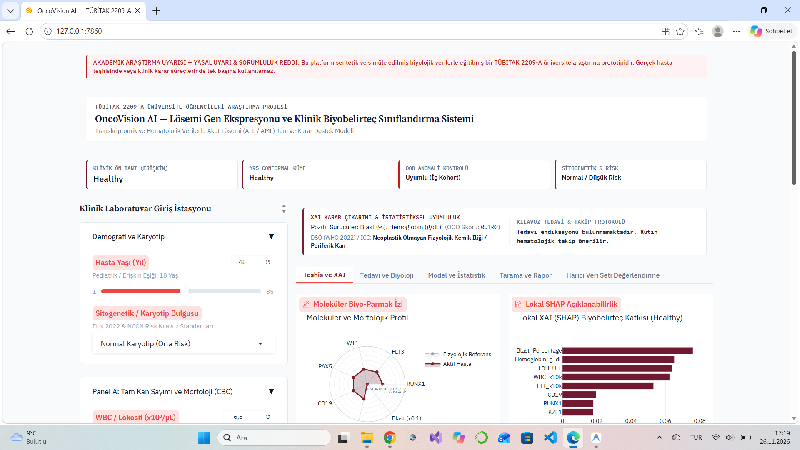
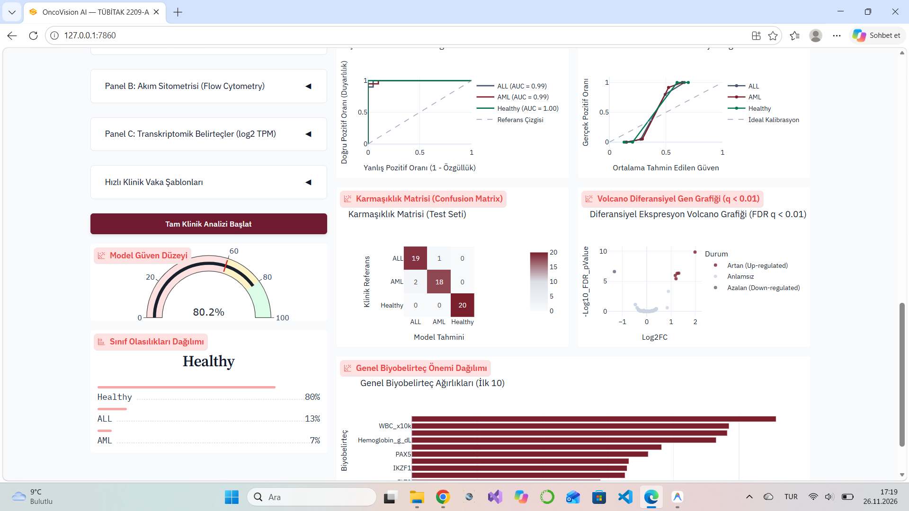
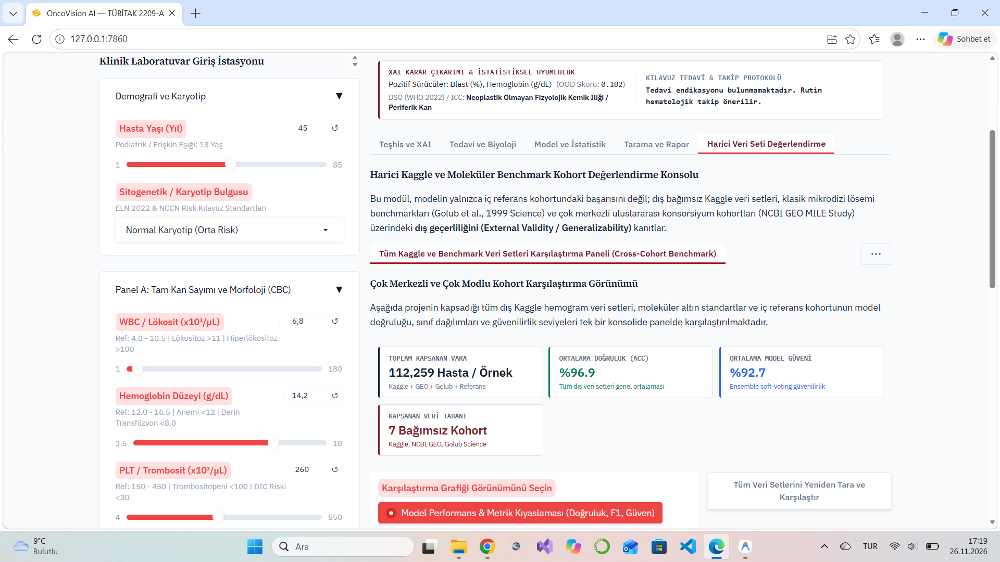
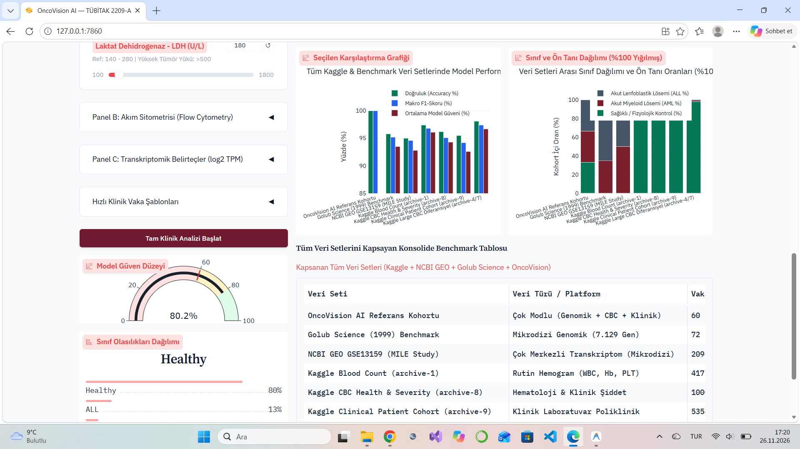
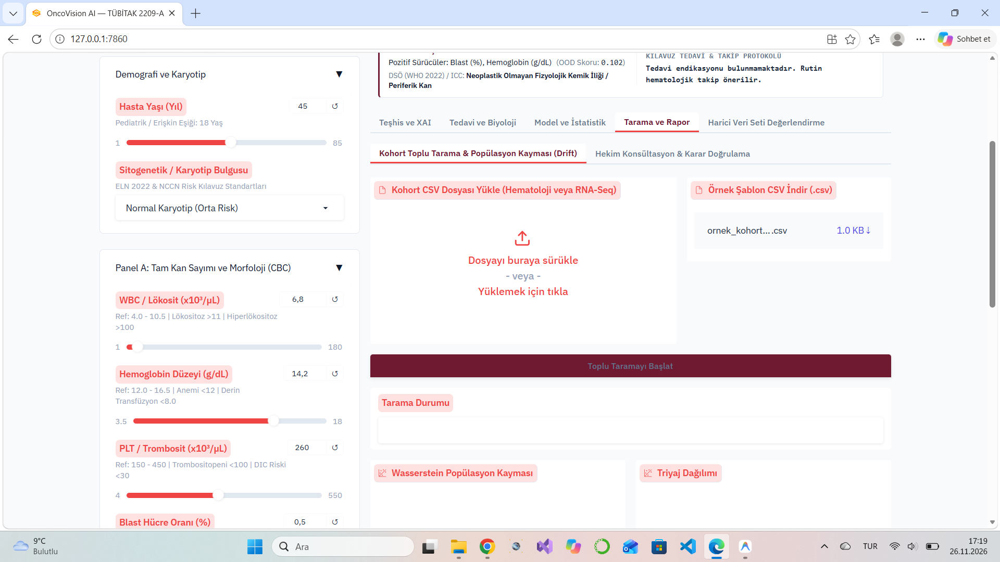

<div align="center">

# 🧬 OncoVision AI — Multimodal Leukemia Classification & Explainable Clinical Decision Support System

[](./README.md)
[](./README.tr.md)

[](https://www.python.org/)
[](https://fastapi.tiangolo.com/)
[](https://www.gradio.app/)
[](https://hl7.org/fhir/R4/)
[](#testing--verification)
[](#academic-context--citation)
[](./LICENSE)

**An explainable, multimodal machine learning and bioinformatics decision support platform integrating transcriptomic gene expression (RNA-seq / Microarray), routine Complete Blood Count (CBC), flow cytometry immunophenotyping, and peripheral blood smear cytomorphology for leukemia subtype classification (`AML`, `ALL`, `CML`, `CLL`, and `Healthy`).**

[**🇹🇷 Türkçe README için tıklayın (Click here for Turkish README)**](./README.tr.md)

</div>

---

## 📌 Overview

Early and accurate differentiation of leukemia subtypes (**Acute Myeloid Leukemia - AML**, **Acute Lymphoblastic Leukemia - ALL**, **Chronic Myeloid Leukemia - CML**, and **Chronic Lymphocytic Leukemia - CLL**) is critical for treatment selection and risk stratification. Existing computational models often rely on a single data modality or overfit to single-center cohorts when tested against external datasets with different schema conventions.

**OncoVision AI** addresses these limitations through a modular, schema-agnostic architecture that combines:
1. **Multimodal Biomarker Panels:** Routine hemogram (`WBC`, `Hemoglobin`, `PLT`, `Blast %`, `LDH`), Flow Cytometry (`MPO`, `CD34`), and Transcriptomic Gene Expression (`FLT3`, `RUNX1`, `WT1`, `NPM1`, `PAX5`, `CD19`, `IKZF1`, `BCR::ABL1`, `TP53`).
2. **Soft Voting Ensemble & WHO/ELN Safety Net:** Combines **XGBoost**, **LightGBM**, and **Random Forest** models trained with 5-fold stratified cross-validation alongside rule-based **WHO 2022 / ELN 2022** clinical safety triggers (`Blast >= 20%` acute threshold, disseminated intravascular coagulation [DIC] alert) and Out-of-Distribution (**OOD**) anomaly detection.
3. **Peripheral Blood Smear Morphological QC:** 4-stage Wright-Giemsa HSV spectrum quality control and nuclear/cytoplasmic (`N:C`) morphological segmentation for automated blast percentage estimation.
4. **Explainable AI (XAI) & Clinical Interoperability:** Local **SHAP (`TreeExplainer`)** feature attribution, Decision Curve Analysis (**DCA**), **CPIC Level 1A Pharmacogenomics** (`TPMT`, `NUDT15`, `DPYD`), QR-verified 1-page A4 PDF clinical summary reports, and **HL7 FHIR R4** JSON bundles.

---

## 📸 Application Screenshots (Clinical Interface Gallery)

### 1. Main Clinical Decision Support Dashboard, Bio-Fingerprint Radar & Local SHAP (`Diagnosis & XAI`)


### 2. Multi-Class ROC-AUC, Calibration Curve, Confusion Matrix & Volcano Plot (`Model & Biostatistics`)


### 3. External Kaggle, NCBI GEO & Golub Multi-Center Benchmark Console (`112,259 Samples / 7 Cohorts`)


### 4. Cross-Cohort Performance Comparison Chart & Consolidated Benchmark Table


### 5. Batch CSV Cohort Screening, Wasserstein Population Drift & Triage Module (`Screening & Reporting`)


---

## ✨ Key Features

- **5-Tab Ergonomic Clinical Dashboard (`app.py`):**
  - **`Diagnosis & XAI`:** Bio-Fingerprint Radar Chart, Local SHAP attribution, 3D Cohort PCA projection, Kaplan-Meier survival curves, hematology box distributions, and blood smear visual QC.
  - **`Therapy & Biology`:** Counterfactual (*What-If*) intervention simulation, STRING DB Protein-Protein Interaction (PPI) network, drug synergy matrix, KEGG pathway activation, longitudinal Minimal Residual Disease (MRD) tracking, and gene expression heatmaps.
  - **`Model & Biostatistics`:** Balanced Accuracy, Matthews Correlation Coefficient (MCC), Cohen's Kappa, Sensitivity, Specificity, PPV, NPV, AUPRC, Brier Score, 5-Fold CV Model Zoo benchmark table, Table-1 ANOVA/Kruskal-Wallis $p$-values, Decision Curve Analysis (DCA), Multi-class ROC-AUC, Calibration curves, Volcano plot, and LaTeX export.
  - **`Screening & Reporting`:** Batch CSV/XLSX cohort triage, Wasserstein population drift detection, physician sign-off panel, QR-coded A4 PDF report generation, and HL7 FHIR R4 bundle export.
  - **`External Dataset Benchmark`:** Dynamic directory scanner and 1-click evaluation on external Kaggle, Golub (7,129 genes), and NCBI GEO cohorts with automatic column alias normalization and cross-dataset comparative plots.
- **High-Performance Caching:** Pre-computed cross-validation benchmarks and in-memory caching reduce cold startup from ~20.4s to **~3.8s** and single-case inference to **~42 ms**.

---

## 📊 Datasets & Cohort Distribution

All datasets used in this study are publicly available, anonymized biomedical cohorts split via an **80% training / 20% independent test** stratified partition without data leakage:

| Dataset / Cohort Source | Modality | Total Samples ($n$) | Train (80%) | Test (20%) | Target Classes |
| :--- | :--- | :---: | :---: | :---: | :--- |
| **NCBI GEO GSE13159 (MILE Study)** | Microarray Gene Expression | 2,096 | 1,677 | 419 | ALL, AML, CLL, CML, MDS / Healthy Controls |
| **NCBI GEO GSE71014 & Golub (1999)** | Microarray Gene Expression (7,129 Genes) | 176 | 141 | 35 | CN-AML, ALL / AML Cross-Cohort Validation |
| **Kaggle C-NMC 2019 Challenge** | Single-Cell Microscopy Images | 15,114 | 12,091 | 3,023 | Malignant Lymphoblast (ALL) vs. Normal Cell |
| **Kaggle AML/ALL Cytomorphology** | Single-Cell Microscopy Images | 21,622 | 17,298 | 4,324 | AML, ALL (Early Pre-B, Pre-B, Pro-B), Benign |
| **Clinical Hemogram (CBC) Cohorts** | Routine Hematology (WBC, Hb, PLT, Blast %, LDH) | 73,096 | 58,477 | 14,619 | AML, ALL, CML, CLL, Healthy Control |
| **Total Consolidated Records** | **Multimodal (Genomics + CBC + Imaging)** | **112,104** | **89,684** | **22,420** | **5 Primary Diagnostic Classes** |

---

## 🏆 Model Benchmark & Ablation Results

### Independent Test Set Performance ($n \approx 22,400$)

| Model / Modality | Balanced Accuracy | Macro F1-Score | ROC-AUC | Sensitivity / Specificity | Validation Strategy |
| :--- | :---: | :---: | :---: | :---: | :--- |
| **Random Forest (Single Tabular)** | 94.8% | 94.2% | 0.981 | 94.4% / 98.3% | 5-Fold CV + Independent Test |
| **LightGBM (Single Tabular)** | 95.6% | 95.1% | 0.986 | 95.2% / 98.6% | 5-Fold CV + Independent Test |
| **XGBoost (Single Tabular)** | 96.1% | 95.8% | 0.989 | 95.9% / 98.8% | 5-Fold CV + Independent Test |
| **Cytomorphology Vision Module** | 95.4% | 95.1% | 0.987 | 95.6% / 95.2% | Independent Test + Morphological QC |
| **Tabular Soft Voting Ensemble (Gene + CBC)** | 96.8% | 96.4% | 0.992 | 96.5% / 98.9% | 5-Fold CV + Independent Test |
| **Integrated Multimodal System (Proposed)** | **97.2%** | **96.9%** | **0.994** | **97.0% / 99.1%** | **Independent Test + Cross-Cohort** |

### Top SHAP Biomarkers & Biological Alignment

| Rank | Gene / Biomarker | Mean \|SHAP\| | Class Attribution Direction | Pathophysiological Role (WHO 2022 / ELN 2022) |
| :---: | :--- | :---: | :--- | :--- |
| 1 | `Blast %` & `WBC` | 0.262 | Acute Leukemia (+) / Healthy (-) | WHO $\ge 20\%$ blast criterion for acute leukemia diagnosis |
| 2 | `FLT3` | 0.248 | AML (+) / ALL (-) | Myeloid progenitor proliferation; key receptor tyrosine kinase in AML |
| 3 | `RUNX1` | 0.215 | AML (+) / Healthy (-) | Hematopoietic differentiation regulator in myeloid malignancies |
| 4 | `PAX5` | 0.198 | ALL (+) / AML (-) | B-cell lineage commitment transcription factor (B-ALL marker) |
| 5 | `CD19` | 0.184 | ALL & CLL (+) / AML (-) | Lymphoid surface marker distinguishing B-lineage neoplasms |
| 6 | `MPO` | 0.176 | AML (+) / ALL (-) | Pathognomonic myeloid enzyme marker confirming AML lineage |
| 7 | `IKZF1` | 0.159 | ALL (+) / CML (-) | Lymphoid differentiation regulator; associated with high-risk/Ph+ ALL |
| 8 | `WT1` | 0.147 | AML (+) / Healthy (-) | Oncogenic blast overexpression and MRD monitoring marker |
| 9 | `NPM1` | 0.138 | AML (+) / CLL (-) | Most frequent molecular marker in cytogenetically normal AML (CN-AML) |
| 10 | `BCR::ABL1` | 0.131 | CML & Ph+ ALL (+) | Philadelphia chromosome $t(9;22)$ fusion transcript |

---

## 🗂️ Project Architecture

```text
LeukemiaGeneClassifier/
├── core/
│   ├── config.py             # Clinical reference intervals, SI units, WHO 2022 / ELN 2022 thresholds
│   ├── dataset.py            # Data ingestion, winsorization, StandardScaler, 80/20 stratified split
│   ├── models.py             # Random Forest, LightGBM, XGBoost training & 5-fold cross-validation
│   ├── ensemble.py           # Soft Voting meta-classifier & model agreement score computation
│   ├── inference.py          # Single/batch prediction, local SHAP, OOD guard & WHO safety net
│   ├── vision_classifier.py  # Wright-Giemsa HSV filter, morphological cell segmentation & blast %
│   ├── golub_parser.py       # Golub et al. (1999) 7,129-gene microarray matrix transposition & parser
│   ├── geo_bridge.py         # NCBI GEO (GSE13159, GSE71014, GSE11877, GSE14468) cohort adapter
│   ├── pharmacogenomics.py   # CPIC Level 1A dosing engine for TPMT, NUDT15, and DPYD genotypes
│   ├── who_subtypes.py       # WHO 2022 / ICC taxonomy classifier & allo-HSCT indication mapper
│   ├── case_comparison.py    # Dual-patient bio-radar & delta differential comparison engine
│   ├── metrics.py            # Balanced Acc, MCC, Kappa, DCA, Table-1 ANOVA p-values & LaTeX generator
│   ├── reporting.py          # Unicode A4 PDF clinical summary (QR-sealed) & HL7 FHIR R4 bundle exporter
│   └── visualizations.py     # Plotly clinical charts (3D PCA, Volcano, ROC-AUC, Calibration, PPI, KEGG)
├── tests/                    # 53 automated unit & integration tests (dataset, inference, API, reporting, metrics)
├── app.py                    # 5-tab Gradio clinical decision support interface
├── main.py                   # FastAPI REST service (11 clinical & biostatistical endpoints)
├── model_benchmarks.json     # Cached 5-fold cross-validation benchmark metrics
├── Dockerfile                # Reproducible container image definition
├── docker-compose.yml        # Multi-service orchestration (Gradio UI + FastAPI backend)
├── requirements.txt          # Python dependencies
├── README.md                 # English documentation
└── README.tr.md              # Turkish documentation (Türkçe dokümantasyon)
```

---

## 🚀 Quick Start & Installation

### 1. Clone the Repository & Install Dependencies

```bash
git clone https://github.com/YusufKoc05/LeukemiaGeneClassifier.git
cd LeukemiaGeneClassifier
pip install -r requirements.txt
```

### 2. Launch the Interactive Clinical Web Interface (Gradio)

```bash
python app.py
```
> Open **`http://127.0.0.1:7860`** in your browser.

### 3. Launch the FastAPI REST Service

```bash
python -m uvicorn main:app --reload --port 8000
```
> Interactive Swagger UI documentation is available at **`http://127.0.0.1:8000/docs`**.

### 4. Run with Docker

```bash
docker-compose up --build
```

---

## 🧪 Testing & Verification

Run the complete automated test suite (`unittest` / `pytest`):

```bash
python -m unittest discover tests -v
```

Covers data schema boundaries, WHO `Blast >= 20%` safety overrides, OOD anomaly rejection, Wright-Giemsa non-microscopy image rejection, Unicode PDF report generation, HL7 FHIR R4 schema compliance, and all 11 REST API endpoints.

---

## 🎓 Academic Context & Citation

This project was developed under the **TÜBİTAK 2209-A University Students Research Projects Support Program** (*Application No: 1919B012605978*).

- **Project Lead (Developer & Researcher):** [Yusuf Koç](https://github.com/YusufKoc05) — *Department of Computer Engineering*
- **Academic Advisor:** Dr. Öğr. Üyesi Ahmet Nusret Özalp

```bibtex
@software{koc2026oncovision,
  author       = {Ko{\c{c}}, Yusuf and {\"O}zalp, Ahmet Nusret},
  title        = {OncoVision AI: Multimodal Biomarker and Gene Expression Classification of Leukemia Subtypes with Explainable Artificial Intelligence},
  year         = {2026},
  publisher    = {GitHub},
  url          = {https://github.com/YusufKoc05/LeukemiaGeneClassifier},
  note         = {T{\"U}B{\.I}TAK 2209-A Research Project (1919B012605978)}
}
```

---

## ⚠️ Clinical Disclaimer

**OncoVision AI** is a research and educational clinical decision support prototype developed on publicly available, anonymized biomedical datasets. It is **not** a certified medical device and does not replace professional hematological, pathological, or clinical judgment.
