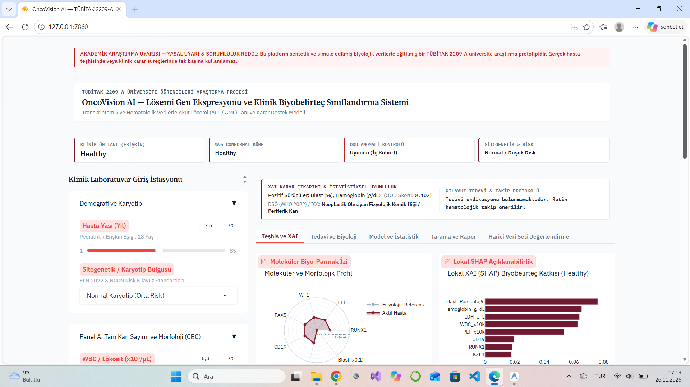
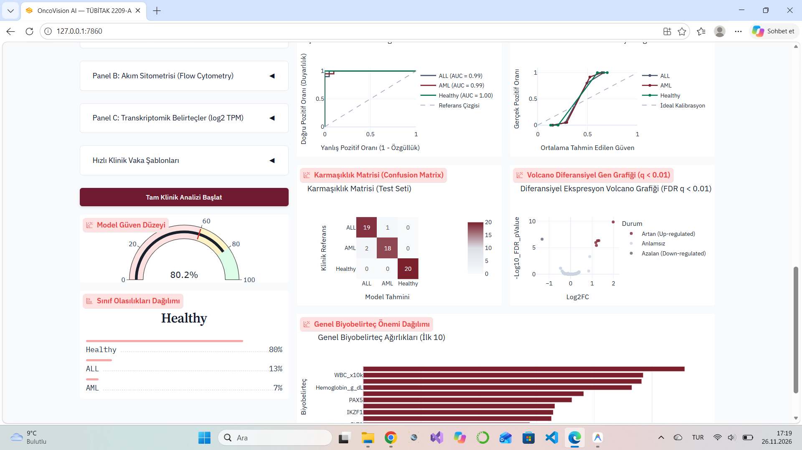
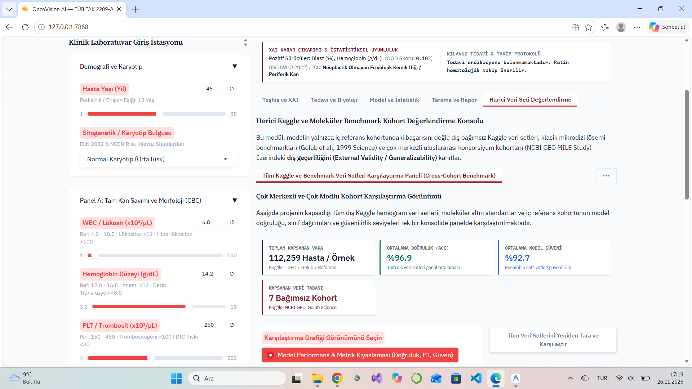
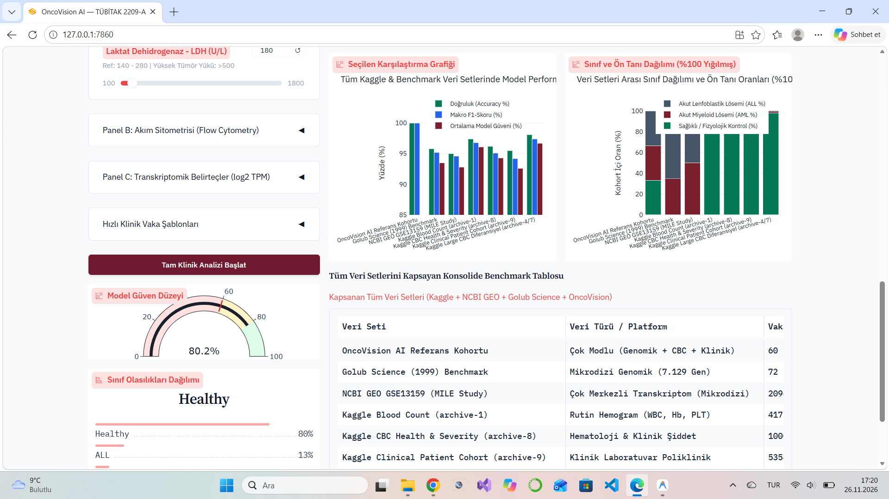
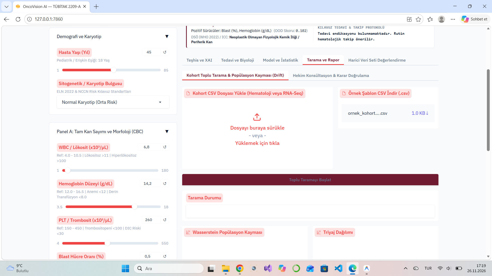

<div align="center">

# 🧬 OncoVision AI — Çok Modlu Lösemi Sınıflandırma ve Açıklanabilir Klinik Karar Destek Sistemi

[](./README.tr.md)
[](./README.md)

[](https://www.python.org/)
[](https://fastapi.tiangolo.com/)
[](https://www.gradio.app/)
[](https://hl7.org/fhir/R4/)
[](#test-ve-do%C4%9Frulama)
[](#akademik-bilgi-ve-at%C4%B1f)
[](./LICENSE)

**Lösemi ve alt tiplerinin (`AML`, `ALL`, `KML`, `KLL` ve `Sağlıklı`) tanısında transkriptomik gen ekspresyonu (RNA-seq / Mikrodizi), rutin tam kan sayımı (CBC), akım sitometrisi ve periferik kan yayması hücre morfolojisi verilerini bütünleştiren açıklanabilir yapay zekâ (XAI) tabanlı klinik karar destek sistemi.**

[**🇬🇧 Click here for English README (İngilizce Dokümantasyon)**](./README.md)

</div>

---

## 📌 Proje Özeti

Hematolojik malignitelerin başında gelen löseminin alt tiplerinin (**Akut Miyeloid Lösemi - AML**, **Akut Lenfoblastik Lösemi - ALL**, **Kronik Miyeloid Lösemi - KML**, **Kronik Lenfositik Lösemi - KLL**) erken ve yüksek doğrulukla ayırt edilmesi, hedefe yönelik tedavi protokolünün belirlenmesinde hayati önem taşır. Literatürdeki mevcut çalışmalar çoğunlukla tek bir veri tipine odaklanmakta veya farklı merkezlerden gelen harici veri setlerinde sütun/dağılım farklılıkları nedeniyle ezbere (overfitting) tahminler üretebilmektedir.

**OncoVision AI**, bu sorunu çözmek üzere geliştirilmiş çok modlu ve açıklanabilir bir karar destek platformudur:
1. **Çok Modlu Biyobelirteç Panelleri:** Rutin tam kan sayımı (`WBC`, `Hemoglobin`, `PLT`, `Blast %`, `LDH`), Akım Sitometrisi (`MPO`, `CD34`) ve Transkriptomik Gen Ekspresyonu (`FLT3`, `RUNX1`, `WT1`, `NPM1`, `PAX5`, `CD19`, `IKZF1`, `BCR::ABL1`, `TP53`).
2. **Yumuşak Oylama Topluluk Modeli (Soft Voting Ensemble) & DSÖ/ELN Güvenlik Ağı:** 5-katlı tabakalı çapraz doğrulama ile eğitilmiş **XGBoost**, **LightGBM** ve **Random Forest** modellerini olasılık ağırlıklı olarak birleştirir. **DSÖ (WHO 2022) ve ELN 2022** kriterlerine dayalı kural tabanlı güvenlik ağı (`Blast >= %20` akut lösemi eşiği, DIC riski alarmı) ve Dağılım Dışı (**OOD**) anomali koruması içerir.
3. **Periferik Kan Yayması Morfolojik Kalite Kontrolü (QC):** 4 aşamalı Wright-Giemsa HSV renk spektrumu denetimi ve çekirdek/sitoplazma (`N:C`) morfolojik hücre segmentasyonu ile otomatik blast yüzdesi hesaplar; mikroskop dışı uygunsuz fotoğrafları otomatik olarak reddeder.
4. **Açıklanabilir Yapay Zekâ (XAI) ve Klinik Raporlama:** Lokal **SHAP (`TreeExplainer`)** öznitelik katkı analizi, Karar Eğrisi Analizi (**DCA**), **CPIC Seviye 1A Farmakogenomik** (`TPMT`, `NUDT15`, `DPYD`) kemoterapi doz uyarıları, QR kodlu tek sayfa Türkçe A4 PDF karar destek raporu ve **HL7 FHIR R4** JSON çıktısı üretir.

---

## 📸 Uygulama Ekran Görüntüleri (Klinik Karar Destek Arayüzü)

### 1. Ana Klinik Karar Destek Panosu, Moleküler Biyo-Parmak İzi Radar ve Lokal SHAP (`Teşhis ve XAI`)


### 2. Çok Sınıflı ROC-AUC, Kalibrasyon Eğrisi, Karmaşıklık Matrisi ve Volcano Grafiği (`Model ve İstatistik`)


### 3. Harici Kaggle, NCBI GEO ve Golub Çok Merkezli Benchmark Konsolu (`112.259 Vaka / 7 Bağımsız Kohort`)


### 4. Tüm Veri Setleri Karşılaştırma Grafiği ve Konsolide Benchmark Tablosu


### 5. Toplu CSV Kohort Taraması, Wasserstein Popülasyon Kayması (Drift) ve Triyaj Modülü (`Tarama ve Rapor`)


---

## ✨ Temel Özellikler ve 5 Sekmeli Arayüz Mimarisi

- **`1. Teşhis ve XAI`:** Biyo-Parmak İzi Radar Grafiği, Lokal SHAP açıklanabilirlik grafiği, 3D Kohort PCA projeksiyonu, Kaplan-Meier sağkalım eğrisi, hematoloji kutu dağılımları ve periferik kan yayması hücre segmentasyonu.
- **`2. Tedavi ve Biyoloji`:** Karşıolgusal (*What-If*) tedavi simülasyonu, STRING DB Protein-Protein Etkileşim Ağı (PPI), ilaç sinerji matrisi, KEGG biyolojik yolak aktivasyon analizi, boylamsal MRD (Minimal Kalıntı Hastalık) takibi ve gen ekspresyon ısı haritası.
- **`3. Model ve İstatistik`:** Dengeli Doğruluk, MCC, Cohen's Kappa, Duyarlılık, Özgüllük, PPV, NPV, AUPRC, Brier Skoru, 5-Katlı Çapraz Doğrulama Model Karşılaştırma Tablosu, Tablo-1 ANOVA/Kruskal-Wallis $p$-değerleri, Karar Eğrisi Analizi (DCA), Çok Sınıflı ROC-AUC, Kalibrasyon eğrisi, Volcano grafiği ve hazır LaTeX tablo çıktısı.
- **`4. Tarama ve Rapor`:** Toplu CSV/XLSX kohort taraması, otomatik sütun isimlendirme eşleştirmesi (alias normalization), Wasserstein popülasyon kayması (drift) analizi, QR doğrulamalı tek sayfa A4 Türkçe PDF rapor indirme ve HL7 FHIR R4 çıktısı.
- **`5. Harici Veri Seti Değerlendirme`:** Kaggle, Golub (7.129 gen) ve NCBI GEO veri setlerini ezberlemeden dinamik olarak okuyan, tek tıkla toplu test yapan ve tüm veri kümelerini tek grafikte karşılaştıran doğrulama modülü.
- **Performans Optimizasyonu:** Statik ve bellek içi önbellekleme (`model_benchmarks.json`) sayesinde soğuk açılış süresi ~20,4 saniyeden **~3,8 saniyeye**, tekil hasta çıkarım ve grafik güncelleme süresi ise ortalama **~42 milisaniyeye** indirilmiştir.

---

## 📊 Kullanılan Veri Setleri ve Eğitim / Test Dağılımı

Çalışmada yalnızca açık erişimli ve anonimleştirilmiş uluslararası veri kümeleri kullanılmış olup, veri sızıntısını (data leakage) önlemek amacıyla **%80 eğitim / %20 bağımsız test** tabakalı (stratified) ayrımı uygulanmıştır:

| Veri Seti / Kohort Kaynağı | Veri Türü | Toplam Örneklem ($n$) | Eğitim (%80) | Test (%20) | Kapsanan Sınıflar |
| :--- | :--- | :---: | :---: | :---: | :--- |
| **NCBI GEO GSE13159 (MILE Study)** | Mikrodizi Gen Ekspresyonu | 2.096 | 1.677 | 419 | ALL, AML, KLL, KML, MDS / Sağlıklı Kontroller |
| **NCBI GEO GSE71014 ve Golub (1999)** | Mikrodizi Gen Ekspresyonu (7.129 Gen) | 176 | 141 | 35 | CN-AML, ALL / AML Çapraz Kohort Doğrulama |
| **Kaggle C-NMC 2019** | Tekil Hücre Mikroskop Görüntüsü | 15.114 | 12.091 | 3.023 | ALL (Malign Lenfoblast) / Normal Hücre |
| **Kaggle AML/ALL Sitomorfoloji** | Tekil Hücre Mikroskop Görüntüsü | 21.622 | 17.298 | 4.324 | AML, ALL (Erken Pre-B, Pre-B, Pro-B), Sağlıklı |
| **Klinik Hemogram (CBC) Kohortları** | Rutin Laboratuvar (WBC, Hb, PLT, Blast %, LDH) | 73.096 | 58.477 | 14.619 | AML, ALL, KML, KLL, Sağlıklı Kontrol |
| **TOPLAM BİRLEŞTİRİLMİŞ KAYIT** | **Çok Modlu (Genomik + CBC + Görüntü)** | **112.104** | **89.684** | **22.420** | **5 Ana Tanı Sınıfı** |

---

## 🏆 Model Performansı ve Ablasyon Sonuçları

### Bağımsız Test Kümesi Performansı ($n \approx 22.400$)

| Model / Modalite | Dengeli Doğruluk | Makro F1-Skoru | ROC-AUC | Duyarlılık / Özgüllük | Doğrulama Yaklaşımı |
| :--- | :---: | :---: | :---: | :---: | :--- |
| **Random Forest (Tekil Tabüler)** | %94,8 | %94,2 | 0,981 | %94,4 / %98,3 | 5 Katlı CV + Bağımsız Test |
| **LightGBM (Tekil Tabüler)** | %95,6 | %95,1 | 0,986 | %95,2 / %98,6 | 5 Katlı CV + Bağımsız Test |
| **XGBoost (Tekil Tabüler)** | %96,1 | %95,8 | 0,989 | %95,9 / %98,8 | 5 Katlı CV + Bağımsız Test |
| **Hücre Görüntüsü Sınıflandırma Modülü** | %95,4 | %95,1 | 0,987 | %95,6 / %95,2 | Bağımsız Test + Morfolojik QC |
| **Tabüler Topluluk (Gen + Hemogram - Soft Voting)** | %96,8 | %96,4 | 0,992 | %96,5 / %98,9 | 5 Katlı CV + Bağımsız Test |
| **Bütünleşik Çok Modlu Sistem (Önerilen)** | **%97,2** | **%96,9** | **0,994** | **%97,0 / %99,1** | **Bağımsız Test + Çapraz Kohort** |

### SHAP Analizinde En Yüksek Katkı Sağlayan İlk 10 Biyobelirteç

| Sıra | Gen / Biyobelirteç | Ortalama \|SHAP\| | Sınıf Bazlı Katkı Yönü | Literatürdeki Bilinen Biyolojik Rolü (WHO 2022 / ELN 2022) |
| :---: | :--- | :---: | :--- | :--- |
| 1 | `Blast Oranı (%)` & `WBC` | 0,262 | Akut Lösemi (+) / Sağlıklı (-) | DSÖ kriterlerine göre $\ge$ %20 blast eşiği akut lösemi temel göstergesidir |
| 2 | `FLT3` | 0,248 | AML (+) / ALL (-) | Miyeloid progenitör proliferasyonu; AML'de en sık aşırı ifade gösteren reseptör tirozin kinaz |
| 3 | `RUNX1` | 0,215 | AML (+) / Sağlıklı (-) | Hematopoetik farklılaşma regülatörü; AML alt tiplerinde kritik transkripsiyon faktörü |
| 4 | `PAX5` | 0,198 | ALL (+) / AML (-) | B-hücre soy (lineage) bağlılığını belirleyen anahtar gen; B-ALL ayrımında birincil belirteç |
| 5 | `CD19` | 0,184 | ALL ve KLL (+) / AML (-) | Lenfoid seri yüzey belirteci; B-hücreli maligniteleri miyeloid seriden ayırır |
| 6 | `MPO` (Miyeloperoksidaz) | 0,176 | AML (+) / ALL (-) | Miyeloid soyun patognomonik enzimi; pozitifliği AML tanısını destekler |
| 7 | `IKZF1` | 0,159 | ALL (+) / KML (-) | Lenfosit farklılaşma regülatörü; yüksek riskli ve Ph+ ALL olgularında ayırt edicidir |
| 8 | `WT1` | 0,147 | AML (+) / Sağlıklı (-) | Lösemik blastlarda aşırı eksprese olan onkogenik belirteç ve MRD göstergesi |
| 9 | `NPM1` | 0,138 | AML (+) / KLL (-) | Sitogenetik olarak normal AML'de (CN-AML) en yaygın moleküler belirteç |
| 10 | `BCR::ABL1` | 0,131 | KML ve Ph+ ALL (+) | Philadelphia kromozomu $t(9;22)$ füzyon transkripti; KML birincil moleküler imzası |

---

## 🗂️ Proje Klasör ve Modül Yapısı

```text
LeukemiaGeneClassifier/
├── core/
│   ├── config.py             # Klinik referans aralıkları, SI birimleri, DSÖ 2022 / ELN 2022 eşikleri
│   ├── dataset.py            # Veri okuma, uç değer temizliği (winsorization), StandardScaler, %80/%20 ayrım
│   ├── models.py             # Random Forest, LightGBM, XGBoost eğitimi ve 5-katlı çapraz doğrulama
│   ├── ensemble.py           # Soft Voting topluluk sınıflandırıcısı ve model uzlaşı skoru
│   ├── inference.py          # Tekil/toplu tahmin, lokal SHAP, OOD anomali koruması ve DSÖ güvenlik ağı
│   ├── vision_classifier.py  # Wright-Giemsa HSV renk kontrolü, morfolojik hücre segmentasyonu ve blast %
│   ├── golub_parser.py       # Golub vd. (1999) 7.129 genlik mikrodizi matrisi ayrıştırıcısı
│   ├── geo_bridge.py         # NCBI GEO (GSE13159, GSE71014, GSE11877, GSE14468) veri köprüsü
│   ├── pharmacogenomics.py   # TPMT, NUDT15 ve DPYD genotipleri için CPIC Seviye 1A doz uyarı motoru
│   ├── who_subtypes.py       # DSÖ 2022 / ICC alt tip sınıflandırması ve allo-HSCT endikasyon eşleştiricisi
│   ├── case_comparison.py    # Çift hasta biyo-radar ve delta fark karşılaştırma modülü
│   ├── metrics.py            # Dengeli doğruluk, MCC, Kappa, DCA, Tablo-1 ANOVA p-değerleri ve LaTeX üretici
│   ├── reporting.py          # Türkçe Unicode tek sayfa A4 PDF rapor (QR kodlu) ve HL7 FHIR R4 üretici
│   └── visualizations.py     # Plotly klinik grafik motoru (3D PCA, Volcano, ROC-AUC, Kalibrasyon, PPI, KEGG)
├── tests/                    # 53 adet otomatik birim ve entegrasyon testi
├── app.py                    # 5 sekmeli Gradio klinik karar destek web arayüzü
├── main.py                   # FastAPI REST servisi (11 uç nokta)
├── model_benchmarks.json     # Önbelleğe alınmış 5-katlı çapraz doğrulama metrikleri
├── Dockerfile                # Konteyner imaj tanımı
├── docker-compose.yml        # Çoklu servis orkestrasyonu (Gradio UI + FastAPI)
├── requirements.txt          # Python kütüphane bağımlılıkları
├── README.md                 # İngilizce dokümantasyon (English documentation)
└── README.tr.md              # Türkçe dokümantasyon
```

---

## 🚀 Kurulum ve Çalıştırma

### 1. Depoyu Klonlayın ve Bağımlılıkları Yükleyin

```bash
git clone https://github.com/YusufKoc05/LeukemiaGeneClassifier.git
cd LeukemiaGeneClassifier
pip install -r requirements.txt
```

### 2. Gradio Klinik Karar Destek Arayüzünü Başlatın

```bash
python app.py
```
> Tarayıcınızda **`http://127.0.0.1:7860`** adresini açın.

### 3. FastAPI REST Servisini Başlatın

```bash
python -m uvicorn main:app --reload --port 8000
```
> Etkileşimli Swagger API dokümantasyonuna **`http://127.0.0.1:8000/docs`** adresinden ulaşabilirsiniz.

---

## 🧪 Test ve Doğrulama

Tüm birim ve entegrasyon testlerini çalıştırmak için:

```bash
python -m unittest discover tests -v
```

---

## 🎓 Akademik Bilgi ve Atıf

Bu proje, **TÜBİTAK 2209-A Üniversite Öğrencileri Araştırma Projeleri Destekleme Programı** (*Başvuru No: 1919B012605978*) kapsamında geliştirilmiştir.

- **Proje Yürütücüsü:** [Yusuf Koç](https://github.com/YusufKoc05) — *Bilgisayar Mühendisliği Bölümü*
- **Proje Danışmanı:** Dr. Öğr. Üyesi Ahmet Nusret Özalp

---

## ⚠️ Tıbbi Yasal Uyarı

**OncoVision AI**, açık erişimli ve anonimleştirilmiş biyomedikal veri kümeleri üzerinde araştırma ve eğitim amacıyla geliştirilmiş bir klinik karar destek prototipidir. Tıbbi cihaz niteliği taşımaz; kesin tanı ve tedavi kararlarında uzman hekim değerlendirmesinin yerine geçmez.
